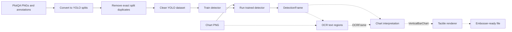

# Experiments and reproduction

This guide collects the dataset preparation, inference, and evaluation commands
for [TactileGen](../README.md). Run them from the repository root. PlotQA data
is downloaded separately and is not included in this repository.

## Architecture

Solid arrows show the dataset preparation and trained-detector inference
available today. Dashed arrows show stages still needed to make a tactile file.



The OpenCV predictors and evaluators provide a separate benchmark for chart
detection. See [chart stage contracts](contracts.md) for the planned
handoffs.

## Trained YOLO detector baseline

The checkpoint at `models/yolo_vbars/best.pt` can run on this machine; it does
not require the original training computer. Install its runtime in a Python
environment (Python 3.12 is supported here):

```bash
python3.12 -m pip install -r requirements-model.txt
```

Smoke-test one image. The command writes a `DetectionFrame` JSON file and an
overlay with predicted vertical bars:

```bash
python3.12 -m src.baseline.yolo_bars predict --image dataset_yolo_vbars_clean/images/test/22415.png --source-key test/22415.png --output-dir output/yolo_prediction
```

Score the checkpoint on the cleaned test split with the same IoU 0.5,
one-to-one bar matching used by the OpenCV baseline. The fixed confidence
threshold is 0.25; `--limit 8` gives a quick smoke test before the full run.
The evaluator saves `metrics.json`, eight contract JSON examples, and eight
overlays.

```bash
python3.12 -m src.baseline.yolo_bars evaluate --data-root dataset_yolo_vbars_clean --split test --weights models/yolo_vbars/best.pt --output-dir output/yolo_test
python3.12 -m src.baseline.opencv_bars evaluate --data-root dataset_yolo_vbars_clean --split test --output-dir output/opencv_clean_test
```

For standard detection mAP, run Ultralytics validation separately on the same
test split. Its mAP and the fixed-threshold bar metrics answer different
questions, so report both with their settings:

```bash
python3.12 -m src.baseline.yolo_bars validate --data-root dataset_yolo_vbars_clean --split test --weights models/yolo_vbars/best.pt --output-dir output/yolo_map_test
```

The checkpoint records `dataset_yolo_vbars_clean/data.yaml` as its training
dataset. Verify that provenance before treating the test score as held-out;
the embedded path alone does not prove which images were used in training.

### Measured clean-test bar detection

Both detectors were evaluated on all 11,242 cleaned test images with one-to-one
box matching at IoU 0.5. YOLO used confidence 0.25.

| Detector | Precision | Recall | F1 | Exact bar count |
| --- | ---: | ---: | ---: | ---: |
| OpenCV | 0.9537 | 0.7630 | 0.8477 | 0.4745 |
| YOLO `best.pt` | 0.9917 | 0.9416 | 0.9660 | 0.7917 |

The machine-readable reports are `output/opencv_clean_test/metrics.json` and
`output/yolo_test/metrics.json`. These values measure bar detection; they do
not measure OCR, chart interpretation, or tactile rendering.

Standard Ultralytics validation on the same test split gave overall box
mAP50 **0.8325** and mAP50–95 **0.8141** across the roles present in these
charts. Vertical-bar mAP50–95 was **0.9317**. Its machine-readable report is
`output/yolo_map_test/metrics.json`.

## Set up
1. Download images and train annotations from [PlotQA Dataset](https://github.com/NiteshMethani/PlotQA/blob/master/PlotQA_Dataset.md)
2. Run `python3 src/dataset/prepare_plotqa.py` from the repository root to get data ready for YOLO.

To prepare only vertical categorical bar charts, use a new output directory:

```bash
python3 src/dataset/prepare_plotqa.py --chart-types vbar_categorical --output dataset_yolo_vbars
```

Pass multiple types after `--chart-types` to include each of them, for example
`--chart-types vbar_categorical hbar_categorical`. Supported types are
`hbar_categorical`, `vbar_categorical`, `dot_line`, and `line`. Without the option,
all four types are included. Filtered runs require an output directory with no
existing images or labels in the selected split. Use `--split val` or `--split test`
with the corresponding PlotQA image directory and annotation JSON. Conversion
also writes `chart_types_<split>.csv` for image-level chart-type ground truth.

## OpenCV vertical-bar baseline

Install the baseline dependencies in a virtual environment:

```bash
python3 -m pip install -r requirements.txt
```

The OpenCV predictor detects vertical bars from pixels only. For a single PNG:

```bash
python3 -m src.baseline.opencv_bars predict --image data/png_validation/22410.png --output-dir output/prediction
```

The existing `dataset_yolo_vbars` directory has train images and YOLO labels.
Use it to check that the pipeline runs, then convert PlotQA validation data into
the same directory for a provisional score:

```bash
python3 src/dataset/prepare_plotqa.py --annotations data/annotations_validation.json --images data/png_validation --output dataset_yolo_vbars --split val --chart-types vbar_categorical
python3 -m src.baseline.opencv_bars evaluate --data-root dataset_yolo_vbars --split val --output-dir output/validation
```

Evaluation reads YOLO labels only after prediction. It reports precision,
recall, F1, and exact bar-count accuracy at box IoU 0.5. A train-split run is
only a smoke test, not an unbiased accuracy estimate. After downloading the
official test annotation JSON, score the untouched test split with:

```bash
python3 src/dataset/prepare_plotqa.py --annotations data/annotations_test.json --images data/png_test/png --output dataset_yolo_vbars --split test --chart-types vbar_categorical
python3 -m src.baseline.opencv_bars evaluate --data-root dataset_yolo_vbars --split test --output-dir output/test_vertical_full
```

PlotQA reuses numeric image IDs across splits. Keep each PNG directory paired
with its own annotation JSON; copying validation PNGs over `data/png` makes the
training annotations incorrect.

## Remove exact image leakage before YOLO training

Some PlotQA vertical-bar images are byte-identical across official splits. From
the repository root, prepare all three splits, then create a cleaned copy:

```bash
python3 src/dataset/remove_split_leakage.py
```

For matching images, the command keeps the test copy first, then validation,
then training. It writes `leakage_report.json` with removed IDs and hashes, and
`data.yaml` with the split paths and 15 class names. Use the clean dataset for
YOLO training and evaluation; models trained on the original data need
retraining. This checks byte-identical PNGs only.

The output directory must be new. To run the cleaner again, pass a different
`--output` path. PNGs in the cleaned dataset are hard-linked to the source to
save disk space, so editing one also changes the corresponding source PNG.
Keep source and output on the same filesystem.

For the experimental four-type baseline, convert the full validation split and
run the chart predictor. It returns one of the four PlotQA types and the
corresponding data-mark boxes. The report includes chart-type accuracy and
mark detection with predicted type and known type; the known-type result is a
diagnostic only, since it uses annotation metadata to select a detector.

```bash
python3 src/dataset/prepare_plotqa.py --annotations data/annotations_validation.json --images data/png_validation --output dataset_yolo_all --split val
python3 -m src.baseline.opencv_charts predict --image data/png_validation/5571.png --output-dir output/chart_prediction
python3 -m src.baseline.opencv_charts evaluate --data-root dataset_yolo_all --split val --limit-per-type 100 --output-dir output/chart_validation_sample
```

`--limit-per-type` selects a reproducible random sample (seed 0) from each
chart type. Remove it to evaluate the complete validation split. The
line-segment boxes in PlotQA are often extremely thin; interpret their box-IoU
score separately from bar and dot scores. The conversion command prints how
many zero-area annotations could not be encoded as YOLO boxes.

Prepare the all-type test split with `--annotations data/annotations_test.json`,
`--images data/png_test/png`, and `--split test`, then run
`opencv_charts evaluate --data-root dataset_yolo_all --split test`. Omit
`--limit-per-type` to score all test charts.

See [chart stage contracts](contracts.md) for the shared detection, OCR, and
vertical-bar data formats used by future pipeline stages.
